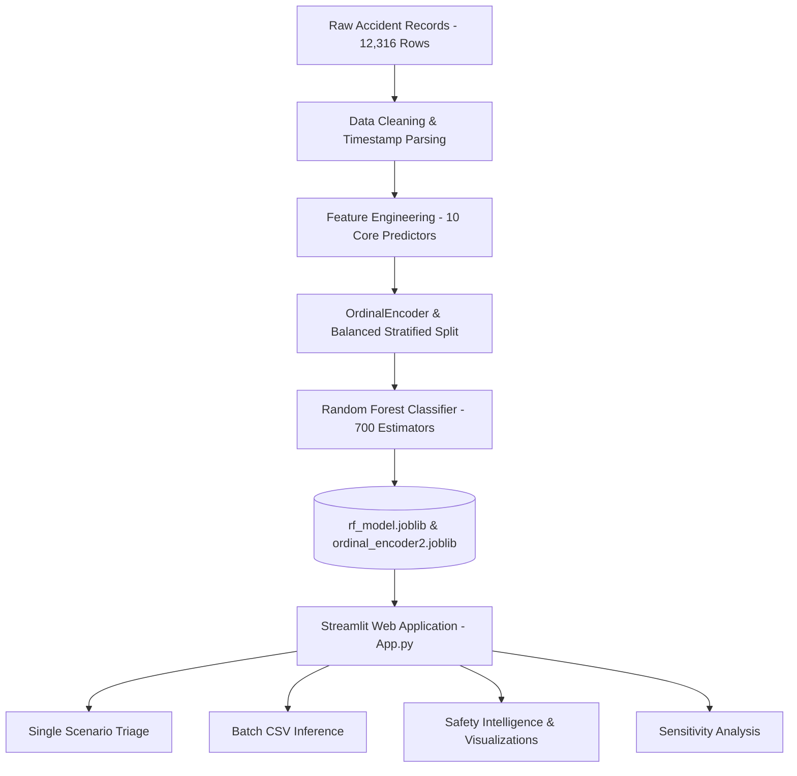

# 🚗 Road Traffic Accident Severity Prediction & Safety Intelligence System

[](https://www.python.org/)
[](https://streamlit.io/)
[](https://scikit-learn.org/)
[](LICENSE)

An end-to-end Machine Learning decision-support and traffic safety intelligence platform built to predict the severity of road traffic collisions, evaluate risk probabilities, guide emergency response dispatch, and uncover road safety insights.

---

## 📌 Table of Contents
- [Executive Overview](#executive-overview)
- [Key Features](#key-features)
- [System Architecture](#system-architecture)
- [Dataset & Preprocessing](#dataset--preprocessing)
- [Project Directory Structure](#project-directory-structure)
- [Installation & Setup](#installation--setup)
- [Running the Application](#running-the-application)
- [Retraining the Model](#retraining-the-model)
- [Verification & Automated Tests](#verification--automated-tests)
- [Responsible AI & Limitations](#responsible-ai--limitations)

---

## 🌟 Executive Overview
Road traffic accidents are one of the leading global causes of severe injury and mortality. When a collision occurs, rapid assessment of potential severity allows emergency services (police, paramedics, fire rescue) to prioritize resource allocation, dispatch appropriate trauma care, and reduce response latency.

This project utilizes real-world traffic accident records collected by the **Addis Ababa Sub-City Police Department (2017–2020)** containing 12,316 incidents and 32 initial variables to train high-performance multi-class classification models.

### Target Classes:
- **💀 Fatal injury (Class 0):** Immediate or hospital fatality.
- **⚠️ Serious Injury (Class 1):** Hospitalization and severe physical trauma.
- **🩹 Slight Injury (Class 2):** Minor injuries or vehicle property damage.

---

## 🚀 Key Features

### 1. 🎯 Interactive Single-Scenario Predictor
- Input environmental context, driver demographics, vehicle properties, and collision types.
- Instant severity classification with **calibrated probability distributions** across all three injury tiers.
- **Emergency Dispatch Triage Protocol**: Automatically maps severity to emergency response priorities (Code Red, Code Yellow, Code Green).
- **Contextual Safety Recommendations**: Actionable guidance for first responders and investigators.
- **1-Click Pre-configured Scenarios**: Instantly test typical city fender-benders, nighttime pileups, or high-speed pedestrian collisions.

### 2. 📁 Batch CSV Scoring
- Upload CSV datasets containing multiple accident records.
- Automatically processes and appends predicted severity labels and individual class probabilities.
- Summary visualization of batch severity distributions and 1-click download of enriched CSV results.
- Includes a built-in downloadable CSV template.

### 3. 📊 Safety Analytics & Exploratory Data Analysis (EDA)
- Hourly accident frequency curve highlighting peak hazard windows (e.g., evening rush hour 16:00–19:00).
- Collision type breakdown and fatality risk analysis.
- Day-of-week incident comparisons and target class imbalance visualization.

### 4. ⚖️ What-If & Sensitivity Simulator
- Dynamic sensitivity simulator: freeze driver and location parameters and view how shifting casualties (1 to 8) or time of day dynamically shifts the fatality and injury probability curve.

### 5. 🛡️ Robust & Resilient Engineering
- Caching with `@st.cache_resource` and `@st.cache_data` for sub-25ms response latency without reloading 28MB model weights on every rerun.
- Robust input handling with automatic whitespace trimming, case-normalization, and graceful fallbacks for unexpected categories.
- Fixed out-of-range slider defaults and resolved duplicate options.

---

## 🏗️ System Architecture



### Evaluated Model Features:
1. `Number_of_vehicles_involved` (Continuous slider: 1–7)
2. `Number_of_casualties` (Continuous slider: 1–8)
3. `Hour_of_Day` (Extracted from collision timestamp: 0–23)
4. `Type_of_collision` (Categorical, Ordinal Encoded)
5. `Age_band_of_driver` (Categorical, Ordinal Encoded)
6. `Sex_of_driver` (Categorical, Ordinal Encoded)
7. `Educational_level` (Categorical, Ordinal Encoded)
8. `Service_year_of_vehicle` (Categorical, Ordinal Encoded)
9. `Day_of_week` (Categorical, Ordinal Encoded)
10. `Area_accident_occured` (Categorical, Ordinal Encoded)

---

## 📂 Project Directory Structure

```text
Accidents/
├── accident.csv             # Historical police accident dataset (12,316 rows)
├── accidents.ipynb           # Exploratory data science & research notebook
├── App.py                   # Production Streamlit web application
├── bannerimage.jpg          # Header banner visual asset
├── ordinal_encoder2.joblib  # Serialized scikit-learn OrdinalEncoder
├── rf_model.joblib          # Serialized Random Forest Classifier
├── train_pipeline.py        # Reproducible training & evaluation script
├── test_app.py              # Automated verification & test suite
├── requirements.txt         # Project dependencies
├── .gitignore               # Git ignore configuration
└── README.md                # Project documentation
```

---

## 💻 Installation & Setup

### Prerequisites
- Python 3.10, 3.11, 3.12, or 3.13
- Git

### 1. Clone or Navigate to the Workspace
```bash
cd c:/Users/nober/Desktop/ML/Accidents
```

### 2. Create and Activate a Virtual Environment
```bash
# Windows (PowerShell)
python -m venv venv
.\venv\Scripts\Activate.ps1

# Linux / macOS
python -m venv venv
source venv/bin/activate
```

### 3. Install Dependencies
```bash
pip install -r requirements.txt
```

---

## 🚀 Running the Application

Launch the interactive Streamlit dashboard:

```bash
streamlit run App.py
```

Once started, open your web browser at:
`http://localhost:8501`

---

## 🔄 Retraining the Model

To retrain the model with balanced class weights, custom tree depths, or updated datasets:

```bash
python train_pipeline.py --data accident.csv --trees 700 --depth 20
```

This will:
- Process the dataset and handle missing values.
- Fit a new `OrdinalEncoder` and stratified train/test split.
- Train the `RandomForestClassifier` with balanced subsampling.
- Print classification metrics (F1-score, Precision, Recall, Confusion Matrix).
- Save updated `rf_model.joblib` and `ordinal_encoder2.joblib` artifacts.

---

## 🧪 Verification & Automated Tests

To run the automated verification test suite:

```bash
python test_app.py
```

Tests include:
- Required serialized artifact verification.
- Model and encoder deserialization integrity.
- Dimension validation and probability sum convergence ($= 1.0$).
- Boundary and extreme condition edge-case tests.

---

## ⚖️ Responsible AI & Limitations

1. **Extreme Class Imbalance:** Slight Injury constitutes ~84.6% of cases, Serious Injury ~14.1%, and Fatal Injury ~1.3%. Raw accuracy is insufficient; the application reports comprehensive class probabilities and composite hazard metrics to avoid under-detecting critical fatal incidents.
2. **Advisory Decision Support:** This system is intended as an informational tool to assist first responders, municipal traffic managers, and researchers, rather than an autonomous decision maker.
